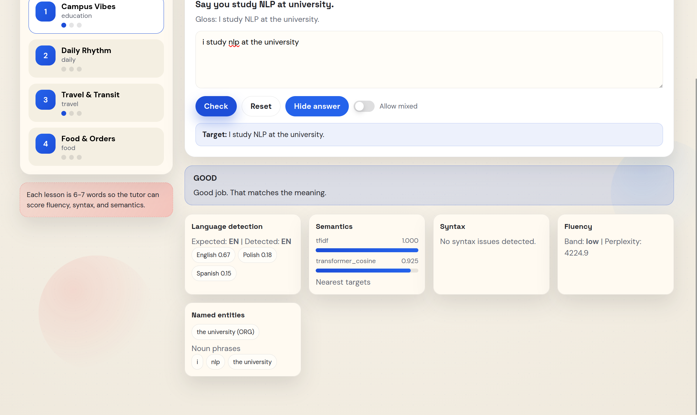
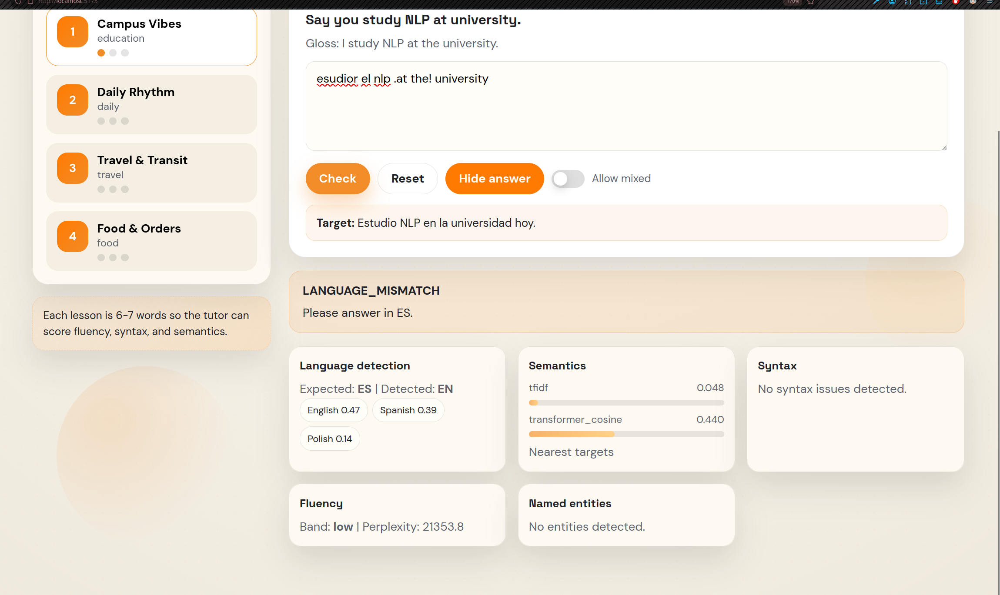
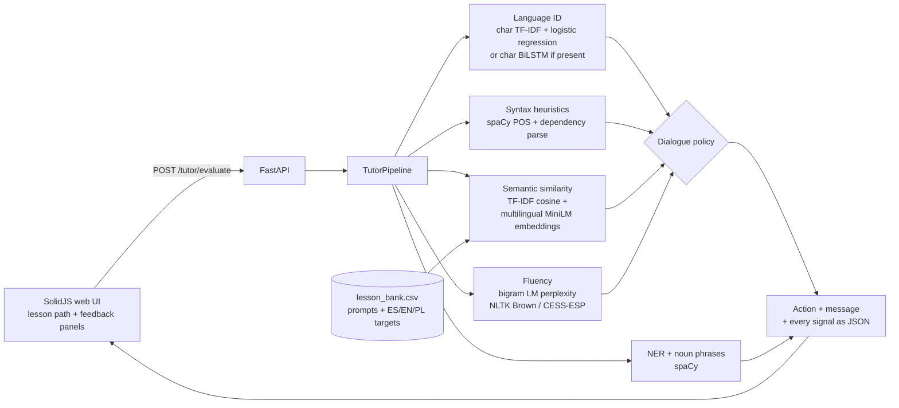

# NLP Adaptive Tutor

A small language-learning tutor that checks a learner's short answer (English, Spanish or Polish) against a lesson target. Its feedback is more specific than right or wrong. It runs five classical and neural NLP checks:

- language identification
- semantic similarity
- syntax heuristics
- named entity recognition (NER)
- n-gram fluency

A rule-based policy turns those signals into one action: `GOOD`, `LANGUAGE_MISMATCH`, `SYNTAX_FIX`, `MEANING_MISMATCH` or `FLUENCY_NUDGE`. A FastAPI backend serves it, and a SolidJS front end ("LinguaTrail") shows every signal next to the verdict, so the learner can see why an answer was marked the way it was.

This was the project for a university NLP module (CMU657, December 2025). The write-up is in [`reports/Project_Report.md`](reports/Project_Report.md).

<p>
  
  
</p>

## How it works



The policy in [`nlp_tutor/dialogue_policy.py`](nlp_tutor/dialogue_policy.py) checks the signals in a fixed order:

1. Wrong language → `LANGUAGE_MISMATCH`
2. Low confidence about the language → `LANGUAGE_UNCERTAIN`
3. Syntax problems, such as a missing main verb or a noun-heavy fragment → `SYNTAX_FIX`
4. Semantic score below 0.80 → `MEANING_MISMATCH`
5. Low fluency → `FLUENCY_NUDGE`, which is a soft hint rather than a block
6. Otherwise → `GOOD`

Answers shorter than three words are rejected up front with `INPUT_TOO_SHORT`.

Components:

| Area | Implementation |
|---|---|
| Language ID | Character TF-IDF + logistic regression ([`lang_detect_baseline.py`](nlp_tutor/classification/lang_detect_baseline.py)), trained on WiLI-2018 (EN/ES/PL). A character-level BiLSTM in PyTorch ([`lang_detect_bilstm_chars.py`](nlp_tutor/classification/lang_detect_bilstm_chars.py)) is used instead when its weights are present. |
| Semantics | TF-IDF cosine against the lesson targets, plus mean-pooled `paraphrase-multilingual-MiniLM-L12-v2` embeddings via Hugging Face `transformers`. Also returns the nearest lesson targets. |
| Syntax | spaCy `*_core_*_sm` models: POS counts, root, and rule-based issue codes. |
| Fluency | Hand-written bigram language model with add-k smoothing ([`ngram_model.py`](nlp_tutor/ngram_model.py)). Perplexity bands are calibrated on the lesson bank. |
| NER | spaCy entities and noun chunks. |
| Extras | Sentiment baselines on IMDB (TF-IDF and BiLSTM). These are training scripts only and are not part of the tutor. |

## Results

**Language identification.** I re-ran this on 29 October 2026: the committed TF-IDF + logistic regression model ([`nlp_tutor/resources/models/`](nlp_tutor/resources/models)) on the full WiLI-2018 test split for English, Spanish and Polish (500 paragraphs each, N = 1,500):

| Input given to the model | Accuracy | Macro F1 |
|---|---|---|
| Full paragraph | 0.9927 | 0.9927 |
| First 50 characters (the training setting) | 0.9860 | 0.9860 |
| First 20 characters | 0.9580 | 0.9581 |

Accuracy drops as the text gets shorter, and the errors are mostly Spanish or Polish predicted as English. Tutor answers are short, which is why the policy has a low-confidence path. An earlier run gave 0.9440 accuracy for the char BiLSTM on the same 1,500 paragraphs. Its weights (`data/models/*.pt`) are git-ignored, so that figure could not be re-checked from this repo.

**Tutor policy.** On a hand-built set of 8 cases, one per expected action, the full pipeline chose the expected action in 8 of 8. Without the syntax check it got 6 of 8, and without the fluency check 7 of 8 ([notebook 03](reports/notebooks/03_tutor_pipeline_evaluation_report.ipynb)). The set is tiny. It shows that each component changes the outcome, not how accurate the tutor is overall.

Further figures, including the confusion matrix, per-class precision, recall and F1, the semantic threshold and a failure case, are in [`reports/images/`](reports/images) and discussed in [`reports/sections/`](reports/sections).

**Tests.** 5 unit tests: the language-ID pipeline shape, the dialogue policy, n-gram perplexity ordering, and the API response schema. Result: `pytest -q` → **5 passed** (Python 3.11, re-run 29 October 2026).

## Running it

Requires Python 3.11+. Node or Bun is needed for the web UI.

```bash
python3 -m venv .venv
source .venv/bin/activate
pip install -r requirements.txt     # includes the three spaCy models and torch
pytest -q
uvicorn api.main:app --reload       # API on http://127.0.0.1:8000
```

```bash
cd web
npm install
npm run dev                         # UI on http://localhost:5173
```

The UI reads `VITE_API_BASE` from `web/.env`. `make dev` runs the API and the UI together. The first request downloads the MiniLM model from Hugging Face, and NLTK corpora are downloaded on first use.

**Known gaps in a fresh clone:**

- `lesson_bank.csv` is not committed, because `.gitignore` excludes `*.csv`. `/health` works, but `/tutor/evaluate` and `/semantic/score` return HTTP 500 until a lesson bank exists. The expected location is `nlp_tutor/resources/lesson_bank.csv`, or set `NLP_TUTOR_LESSON_BANK=/path/to/lesson_bank.csv`. The columns are `lesson_id, item_id, topic, prompt_en, target_es, target_en, target_pl, gloss_en`.
- `npm run build` currently fails TypeScript checks (2 type errors). `npm run dev` still works.
- `requirements.txt` pins CUDA builds of PyTorch. On a CPU-only machine, install `torch` from the CPU wheel index instead.
- Polish fluency needs a local corpus at `nlp_tutor/resources/lm/pl.txt` (one sentence per line) or `NLP_TUTOR_LM_PL`.

### API

`GET /health`

`POST /tutor/evaluate`

```json
{
  "lesson_id": 1,
  "item_id": 1,
  "learner_text": "Estudio NLP en la universidad hoy.",
  "expected_lang": "ES",
  "allow_mixed": false
}
```

Returns the action code and message, detected language with top-k scores, syntax issues, semantic scores and nearest targets, the fluency band and perplexity, and named entities.

`POST /semantic/score` returns similarity scores only.

### Training scripts

```bash
python data/wiLi_2018.py                               # download WiLI-2018 via kagglehub
python scripts/train_language_detection_baseline_wili.py
python scripts/train_language_detection_bilstm_wili.py
python scripts/train_sentiment_baseline.py             # optional, IMDB
python scripts/train_sentiment_bilstm.py
```

## Repository layout

```
api/            FastAPI app, routers, Pydantic schemas, cached app state
nlp_tutor/      pipeline, policy, classifiers, semantics, syntax, fluency, NER
nlp_tutor/resources/   committed language-ID model; optional LM corpora
scripts/        training and helper scripts
tests/          pytest unit tests
web/            SolidJS + Vite front end
reports/        project report, sections, evaluation notebooks, figures
```

## Data and licences

- **WiLI-2018** (Thoma, 2018; [Zenodo 841984](https://doi.org/10.5281/zenodo.841984)), used for language ID. It is listed under the Open Database License (ODbL 1.0). It is downloaded through Kaggle (`mexwell/wili-2018`) and not committed. The committed language-ID model is trained on it.
- **IMDB 50K reviews** (the Kaggle copy of Maas et al., 2011), used for the optional sentiment experiments. It is downloaded by script and not committed.
- **NLTK Brown and CESS-ESP corpora**, used for fluency. They are fetched at runtime through `nltk.download` and carry their own NLTK data licences.
- **The lesson bank** is handwritten and not yet in the repo.

## What I'd do next

- Commit the lesson bank, so the API works straight after cloning.
- Swap the bigram fluency model for a trigram model or a small pretrained language model. Perplexity on 6–7-word answers is noisy, as the very high values in the screenshots show.
- Build a larger labelled set of learner answers, so the policy thresholds (such as the 0.80 semantic cut-off) can be tuned rather than set by hand.
- Fix the TypeScript build errors and add API-level tests.

---

This README was written with [Claude Code](https://claude.com/claude-code) from the code, with the tests and the language-ID evaluation re-run.
